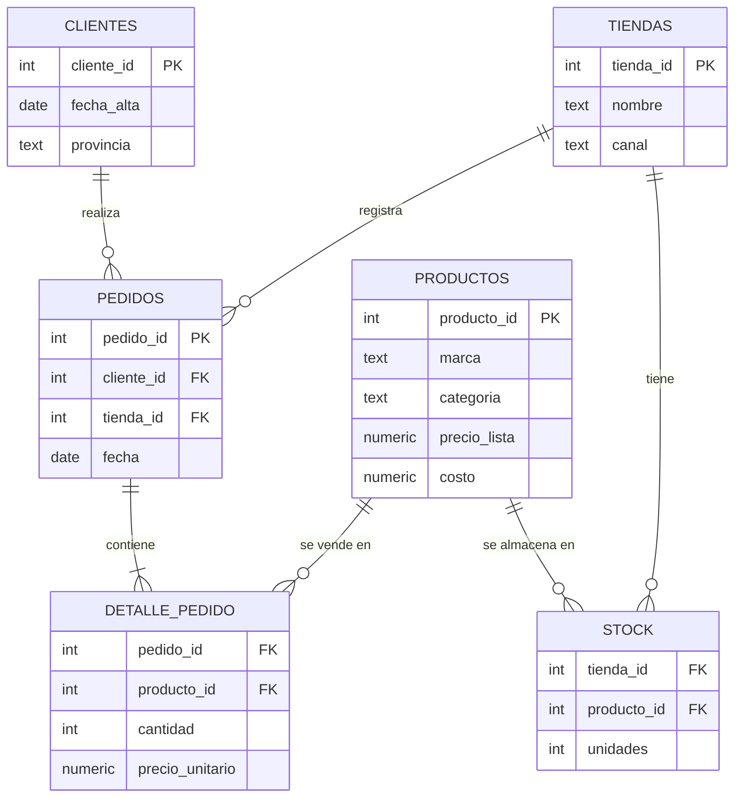

# Análisis de negocio con SQL — retail de indumentaria deportiva


> 🇬🇧 **English summary:** 12 business questions answered with SQL on a retail sales database (9K orders, 2.5K customers, 4 stores incl. e-commerce): Pareto/ABC analysis, cohort retention, RFM segmentation, churn-risk lists, stock coverage, discount-event impact and market-basket analysis. Uses CTEs, window functions (LAG, RANK, NTILE, PERCENT_RANK, running sums, moving averages) and self-joins.

## Qué demuestra este proyecto

Cada consulta responde **una pregunta que haría un gerente**, no un ejercicio de sintaxis. Todas están comentadas con la pregunta de negocio y las técnicas usadas.

| # | Pregunta de negocio | Técnicas SQL |
|---|---|---|
| 01 | ¿Cómo crecen las ventas mes a mes e interanual? | `LAG()`, CTE |
| 02 | ¿Qué % del catálogo genera el 80% de los ingresos? (Pareto/ABC) | `SUM() OVER` acumulado |
| 03 | Top 3 productos por categoría y su margen | `RANK() OVER (PARTITION BY)` |
| 04 | ¿El canal online vende tickets más altos? | ventana con partición por año |
| 05 | Retención de clientes por cohorte trimestral | `MIN() OVER`, pivot con `CASE` |
| 06 | Segmentación RFM de clientes | `NTILE()`, reglas de negocio |
| 07 | Clientes valiosos que dejaron de comprar | `LAG()`, `PERCENT_RANK()`, `HAVING` |
| 08 | Margen bruto por marca | participación sobre el total |
| 09 | Productos que se quedan sin stock en 2 semanas | días de cobertura, `NULLIF` |
| 10 | ¿Los eventos de descuento valen la pena? | comparación contra línea base |
| 11 | Tendencia sin ruido diario | media móvil `ROWS BETWEEN` |
| 12 | ¿Qué categorías se compran juntas? | self-join, soporte, confianza y lift |

📄 **Resultados completos de las 12 consultas:** [`resultados/RESULTADOS.md`](resultados/RESULTADOS.md)

## Hallazgos principales

1. **Concentración del catálogo:** el **28% de los productos genera el 80% de los ingresos**. El 42% del catálogo (clase C) aporta solo el 5%: candidato a racionalizar surtido y liberar capital inmovilizado en stock.
2. **El canal online pasó del 40,7% al 50,5% de los ingresos** entre 2023 y 2024, con un ticket promedio similar al de las tiendas físicas (entre $93 mil y $96 mil).
3. **Retención:** entre el 39% y el 50% de los clientes nuevos vuelve a comprar el trimestre siguiente, y cerca del 20% sigue comprando un año después.
4. **RFM:** los *Campeones* son el 21% de los clientes y generan el **51% de los ingresos**. El segmento *En riesgo* (19% de clientes, 19% de ingresos) son buenos clientes que, en promedio, no compran hace más de un año: la consulta 07 entrega la lista priorizada para una campaña de reactivación.
5. **Eventos de descuento:** el Cyber Monday vende **2,7 veces** un día normal, pero el margen cae del 45% al **28%**. Las Fiestas duplican las ventas sin resignar margen.
6. **Venta cruzada:** *Zapatillas + Accesorios* es la única combinación que se compra junta más de lo esperable por azar (lift 1,26; el 53% de los pedidos con accesorios incluye zapatillas). Es la base para un combo "zapatilla + medias".

## Modelo de datos



Definición completa con restricciones e índices: [`sql/schema.sql`](sql/schema.sql)

## Ejemplo: segmentación RFM

```sql
WITH base AS (
    SELECT p.cliente_id,
           julianday('2024-12-31') - julianday(MAX(p.fecha)) AS dias_desde_ultima,
           COUNT(DISTINCT p.pedido_id)                       AS frecuencia,
           SUM(d.cantidad * d.precio_unitario)               AS monto
    FROM pedidos p
    JOIN detalle_pedido d USING (pedido_id)
    GROUP BY p.cliente_id
),
puntajes AS (
    SELECT *,
           NTILE(5) OVER (ORDER BY dias_desde_ultima DESC) AS r,
           NTILE(5) OVER (ORDER BY frecuencia)             AS f,
           NTILE(5) OVER (ORDER BY monto)                  AS m
    FROM base
)
-- ... clasificación en segmentos y resumen (ver sql/consultas/06_segmentacion_rfm.sql)
```

| Segmento | % clientes | % ingresos | Recencia prom. (días) |
|---|---:|---:|---:|
| Campeones | 21,3 | **51,3** | 44 |
| Leales | 19,8 | 22,2 | 179 |
| En riesgo (eran buenos) | 18,8 | 18,9 | 498 |
| Perdidos | 21,3 | 3,9 | 592 |

## Cómo ejecutarlo

No hace falta instalar nada además de Python 3.10+.

```bash
git clone https://github.com/Lu1sPerez/sql-analisis-retail.git
cd sql-analisis-retail
python scripts/crear_base.py          # crea retail.db con datos sintéticos (2 segundos)
python scripts/ejecutar_consultas.py  # corre las 12 consultas y actualiza resultados/RESULTADOS.md
```

También podés abrir `retail.db` con [DB Browser for SQLite](https://sqlitebrowser.org/) o DBeaver y ejecutar cada archivo de `sql/consultas/`.

**PostgreSQL:** el esquema y la lógica son compatibles. Solo cambian las funciones de fecha: `strftime('%Y-%m', fecha)` → `to_char(fecha, 'YYYY-MM')` y `julianday(a) - julianday(b)` → `a - b`.

## Sobre los datos

Datos **sintéticos** y reproducibles (semilla fija), generados por [`scripts/crear_base.py`](scripts/crear_base.py) con patrones realistas: clientes con distinta frecuencia de compra y abandono, una base de clientes previa a 2023, estacionalidad (Hot Sale, Cyber Monday, Fiestas, vacaciones), crecimiento del canal online, popularidad de productos con distribución de Pareto y canastas con productos complementarios.

---
**Autor:** Luis Pérez · [LinkedIn](https://www.linkedin.com/in/perezluis24/) · Analista de Datos | BI | Automatización
